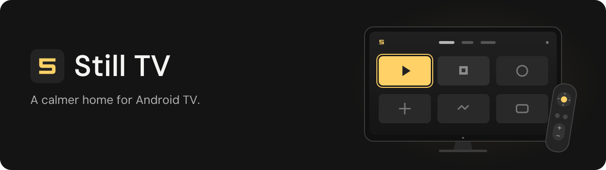
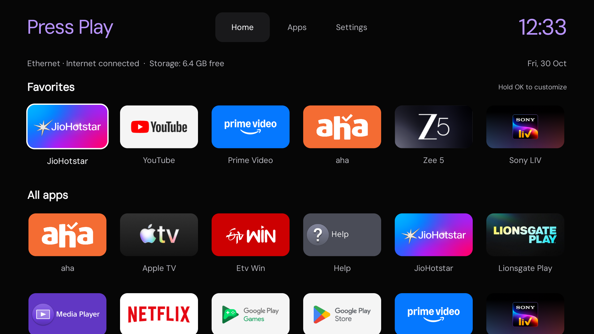

<div align="center">



**A lightweight, native home screen built around your apps.**

[](https://github.com/bhanurp/still-tv/releases/latest)
[](https://github.com/bhanurp/still-tv/actions/workflows/build.yml)
[](https://github.com/bhanurp/still-tv/actions/workflows/release.yml)
[](#get-started)
[](LICENSE)

[**Download APK**](https://github.com/bhanurp/still-tv/releases/latest/download/still-tv.apk) · [**Watch the demo**](#demo) · [**Sony BRAVIA setup**](#sony-bravia-making-still-tv-the-actual-home) · [**Recovery**](#recovery) · [**Build**](#build-from-source)

</div>

## Demo

https://github.com/user-attachments/assets/307e6c93-1d30-4624-87e2-7080323909da

[Download the original 1080p MP4](https://github.com/bhanurp/still-tv/releases/download/v0.1.0/still-tv-navigation.mp4)

<details>
<summary>View the home-screen screenshot</summary>



</details>

<sub>Actual 1080p TV recording, at normal playback speed, with ADB-injected D-pad input. The recording predates the rotating header shown in the screenshot. Video frames and timing are preserved; container metadata is removed. This is a navigation demonstration, not a measurement of physical-remote latency. [Recording details](docs/evidence/navigation.json) · [Rendering measurements and limits](PERFORMANCE.md).</sub>

## Make room for your apps

Still TV brings a spacious app grid, clear D-pad focus and DM Sans typography to Android TV. No recommendation feeds, autoplay previews, ads, analytics or account service. It does not request Android's `INTERNET` permission. Its single normal permission, `ACCESS_NETWORK_STATE`, reads the TV's connection state.

<table>
<tr>
<td width="50%" valign="top"><strong>Built for the remote</strong><br>Large targets, immediate focus feedback and a short, interruptible focus animation. Native Android Views throughout.</td>
<td width="50%" valign="top"><strong>Your favorites, up front</strong><br>Hold OK or press Menu to pin and unpin apps. Favorites and their order stay saved across updates.</td>
</tr>
<tr>
<td width="50%" valign="top"><strong>Choose the mood</strong><br>Dark, Super Dark and Light. Preview Neon amber, Electric violet or Electric cyan before keeping a color.</td>
<td width="50%" valign="top"><strong>Local TV status</strong><br>Connection state, free internal storage and the date replace the greeting. System callbacks and the existing background worker keep it light.</td>
</tr>
<tr>
<td width="50%" valign="top"><strong>Small by design</strong><br>A native Java launcher with no AndroidX or web runtime dependency. The v0.1.0 APK is about 145 KiB.</td>
<td width="50%" valign="top"><strong>A way back home</strong><br>The original launcher stays installed. A tested TV setting and independent ADB tool restore it when needed.</td>
</tr>
</table>

The left header rotates between **19 short phrases**, including “Netflix & Chill,” “Press Play” and “One More Episode,” whenever Home reloads or resumes. The previous phrase is saved to prevent immediate repeats across restarts. Its 32 sp DM Sans type shares the clock's accent; the clock remains 36 sp. Theme and accent previews keep the current phrase. [All 19 phrases fit on the tested TV](docs/evidence/rotating-header.json). **Super Dark + Neon amber** is the default appearance. Accents adapt for contrast in Light.

The compact status strip observes Ethernet, Wi-Fi or VPN connectivity while Home is visible. It distinguishes validated internet access, unverified access, sign-in requirements and offline state. Available internal storage is checked off the UI thread when Home resumes; the date also updates on resume. There are no status polling timers, added worker threads or feed requests. [Local-status checks and performance samples](docs/evidence/local-status.json).

## Get started

**Requires Android TV 8.0 / API 26 or later and authorized ADB for sideloading.** Behavior varies by firmware; the default-Home setup below was verified on one Sony Android 11 TV.

1. Download **[still-tv.apk](https://github.com/bhanurp/still-tv/releases/latest/download/still-tv.apk)** and its **[SHA-256 checksum](https://github.com/bhanurp/still-tv/releases/latest/download/still-tv.apk.sha256)** from the latest stable release.
2. Replace `TV_SERIAL` with your connected TV's ADB serial/address, then install and open it:

```sh
adb -s TV_SERIAL install --no-incremental -r still-tv.apk
adb -s TV_SERIAL shell am start -W -n dev.still.launcher/.MainActivity
```

3. Try navigation, favorites and appearance before changing Home. Use **Settings → Use Still TV as Home** where the firmware supports it. Read [Recovery](#recovery) and save an original-Home snapshot before using the Sony disable workflow.

Installing the app alone does not replace your default Home. Streaming-app freezes and internet buffering have their own causes; this launcher changes the home screen.

### A few remote controls

| Control | Action |
|---|---|
| D-pad + OK | Move focus and open an app |
| Hold OK / Menu | Pin or unpin an app; open Android app information |
| Back | Return to the top and first favorite |
| Settings → Appearance | Preview themes and accent colors |
| Settings → Restore original launcher | Open the system Enable flow if needed, then switch Home back |

## Sony BRAVIA: making Still TV the actual Home

The default-Home and recovery evidence below was captured on one **Sony BRAVIA VU1 running Android 11**, with the **0.2.1 preview**, before naming the current launcher stable **0.1.0**. The Home/recovery implementation is retained in the stable release. The original package on this TV is `com.google.android.tvlauncher`. This is a record of the tested firmware; identify your own original Home from the snapshot before using these steps.

### Switch while keeping the original installed

1. Save `installation-state.json` using the snapshot command above and confirm authorized ADB recovery works.
2. Open **Settings → Use Still TV as Home** to enable Still TV's Home entry. This is necessary if a previous restoration disabled that entry.
3. Confirm Still TV appears among HOME candidates before disabling anything:

```sh
adb -s TV_SERIAL shell cmd package query-activities --brief --user 0 -a android.intent.action.MAIN -c android.intent.category.HOME
```

4. With the owner's approval, disable the original **for the current user**, then assign and verify Still TV. Replace `ORIGINAL_HOME_PACKAGE` with the package saved from your own TV; do not guess it.

```sh
adb -s TV_SERIAL shell pm disable-user --user 0 ORIGINAL_HOME_PACKAGE
adb -s TV_SERIAL shell cmd package set-home-activity --user 0 dev.still.launcher
adb -s TV_SERIAL shell cmd package resolve-activity --brief --user 0 -a android.intent.action.MAIN -c android.intent.category.HOME
```

On the tested Sony, the resolved component became:

```text
dev.still.launcher/.HomeEntry
```

Press Home and verify the screen. Confirm the original remains installed and is listed as disabled:

```sh
adb -s TV_SERIAL shell pm list packages --user 0 ORIGINAL_HOME_PACKAGE
adb -s TV_SERIAL shell pm list packages --user 0 -d ORIGINAL_HOME_PACKAGE
```

5. Verify a real reboot without manually launching Still TV afterward. Our captured check observed a **changed boot ID**, completed Android boot, and `dev.still.launcher/.HomeEntry` in the foreground for **32.6 seconds**. The Home button, six saved favorites and Neon amber were also checked afterward. This is a boot/recovery check, not a startup-time benchmark.

The native restore flow and independent ADB restoration were both tested from the disabled-original state. To switch back, use **Settings → Restore original launcher → Open App information → Enable → OK → Back**. If Enable is unavailable or Still TV is unresponsive, use the recovery tool below. **Keep the original launcher installed throughout.**

<details>
<summary><strong>What made Sony Home difficult to replace — with captured evidence</strong></summary>

### The tricky parts

| Attempt or edge case | What the TV actually did | Resulting approach |
|---|---|---|
| Android's default-Home picker and `set-home-activity` accepted Still TV | The Home button still opened the original, whose HOME filter had priority `2` | Verify actual Home resolution and the remote button, even when the role assignment reports success |
| Set Still TV's manifest priority to `3` | The APK contained `3`, but Android registered it as `0`; Sony stayed at `2` | Increasing to `1`, `2`, or higher cannot avoid Android's positive-priority cap for ordinary apps; the ineffective override was removed |
| Inspect the factory launcher instead of its installed update | The factory APK also declared HOME priority `2` | Removing launcher updates would not solve this mismatch; no updates were removed |
| Open Still TV from a boot-completed receiver | Sony could appear first, then Still TV opened later | This did not meet the first-Home-screen requirement; the final app uses normal HOME selection, without a boot receiver or overlay permission |
| Disable the original but preserve its installation | Still TV immediately resolved Home and handled the Home button | Disable only after explicit owner approval and verified recovery; keep the original package installed |
| Restore a disabled original from an ordinary app | Still TV cannot silently enable another package | Open Android App Info, select **Enable**, confirm **OK**, then press **Back**; recheck before completing restoration |
| A Java crash while original Home is disabled | Disabling Still TV's own Home entry would leave no usable primary launcher | Keep that entry active and offer recovery on the next Home launch; keep independent ADB recovery available |

Android documents the [priority cap for non-privileged apps](https://developer.android.com/guide/topics/manifest/intent-filter-element#priority). The installed APK and resolver were checked separately; editing the manifest alone is not evidence of an effective priority change.

Captured resolver output from the priority-`3` experiment:

```text
priority=2 ...
com.google.android.tvlauncher/.MainActivity
priority=0 ...
dev.still.launcher/.HomeEntry
```

See the [sanitized command output](docs/evidence/sony-bravia-priority.txt) and [verification record](docs/evidence/sony-bravia-home.json). Device addresses, account details, boot identifiers, full system logs and pulled APKs are excluded.

</details>

## Recovery

```sh
# Inspect the planned recovery without changing the TV:
python3 tools/recover.py restore --dry-run

# Restore and open original Home; keep Still TV and its preferences:
python3 tools/recover.py restore

# Restore original Home first, then remove only Still TV and its user data:
python3 tools/recover.py restore --uninstall
```

Recovery verifies that original Home is installed, re-enables it if needed and verifies that state, restores and reads back its default assignment, requires a successful launch and checks the foreground Activity before stopping or removing Still TV. If verification fails, Still TV is not removed. **The tool never disables or uninstalls the original launcher.** See [RECOVERY.md](RECOVERY.md).

## Build from source

Requires a JDK 17 and Android SDK 35 platform/build-tools. A local helper downloads official tools with checksum verification on macOS (Apple Silicon or Intel) and x86_64 Linux:

```sh
python3 tools/bootstrap.py
sh test.sh
sh build.sh
```

Output: `build/still-tv.apk`. No Gradle or AndroidX dependencies are required. `curl`, Python 3 and `zip` must be available. SDK/JDK usage is subject to their respective licenses.

With an existing compatible toolchain, set `STILL_JAVA_HOME`, `STILL_BUILD_TOOLS`, and `STILL_ANDROID_JAR` to your JDK directory, build-tools directory, and `android.jar` file.

Local builds generate an ignored signing key in `build/`. Keep that key and its password file to sign compatible updates. CI artifacts use temporary build keys and are development builds, not a stable update channel. Do not publish your private signing key.

## Releases

[release.yml](.github/workflows/release.yml) builds and publishes a signed `still-tv.apk` and `still-tv.apk.sha256` when a version tag is pushed. It also supports **Actions → Release Android APK → Run workflow** with an existing tag. The tag must match the manifest's `versionName`, prefixed with `v`.

The workflow requires Actions secrets **STILL_SIGNING_KEYSTORE_BASE64** and **STILL_SIGNING_PASSWORD** for the existing `still-tv` signing alias. It fails if signing material is absent or invalid, cleans it up after the job, and preserves published APKs/checksums on reruns. Keep using the same key for compatible updates; never commit signing material or attach it to releases.

Current source prepares **v0.3.0**, with Android **versionCode 5** for compatible updates over v0.1.0 (code 4) and the earlier previews. The first stable release was v0.1.0; the v0.2.0/v0.2.1 preview tags remain historical releases. Android version codes increase independently of the public version name. See the [v0.3.0 release notes](docs/releases/v0.3.0.md).

The [navigation recording](https://github.com/bhanurp/still-tv/releases/download/v0.1.0/still-tv-navigation.mp4) comes from the actual TV at normal playback speed, using ADB-injected D-pad input. It is an interface demonstration, not a remote-to-photon latency benchmark. Recording can add load. Only video-container metadata is removed; video frames and timing are preserved. See the [recording details](docs/evidence/navigation.json) and [PERFORMANCE.md](PERFORMANCE.md) for measured rendering samples and their limitations.

<details>
<summary>Build and preview while leaving your current Home unchanged</summary>

### Preview without changing Home

Connect your TV through authorized ADB. Replace `TV_SERIAL` with its connected ADB serial/address:

```sh
python3 tools/recover.py snapshot --device TV_SERIAL
adb -s TV_SERIAL install --no-incremental -r build/still-tv.apk
adb -s TV_SERIAL shell am start -W -n dev.still.launcher/.MainActivity
```

The snapshot saves your original launcher and device locally in `installation-state.json`, excluded from Git. Preserve that file. The preview does not change the default launcher; pressing Home still opens your existing Home.

To make Still TV the default, use **Settings → Use Still TV as Home** and accept the Android Home selection where available. On firmware that requires authorized ADB, enable its Home entry and assign it:

```sh
adb -s TV_SERIAL shell cmd package set-home-activity --user 0 dev.still.launcher
```

If the Home entry was previously disabled by restoration, first select **Use Still TV as Home** in the app. Some TVs give their system launcher higher intent priority: even a successful ADB Home-role assignment may leave the original handling Home. Verify the actual Home button; the default chooser cannot override that priority. An owner-authorized disable workflow is described below.

**Settings → Restore original launcher** removes only Still TV’s Home entry from selection and opens the saved original launcher. Still TV remains available in Apps. Verify recovery on your own firmware before switching. Never uninstall the original launcher.

</details>

## License and warranty

Licensed under the [MIT License](LICENSE). Provided **AS IS, without warranty**, with the license's disclaimer of author/copyright-holder liability. Nothing here promises universal compatibility or unconditional recovery. A disclaimer is not a guarantee of immunity from every legal claim.

Third-party apps and their names, icons and banners belong to their respective owners. App artwork is read from packages already installed on the TV and is not bundled with this project. This project is independent of Apple, Google and TV manufacturers.

DM Sans is bundled under the [SIL Open Font License](app/assets/fonts/OFL.txt), separate from the MIT license for the launcher code. Font source: [Google Fonts / DM Sans](https://github.com/google/fonts/tree/main/ofl/dmsans).

<div align="center">


Made by [bhanureddy.dev](https://bhanureddy.dev) · [Releases](https://github.com/bhanurp/still-tv/releases) · [Report an issue](https://github.com/bhanurp/still-tv/issues)
</div>
